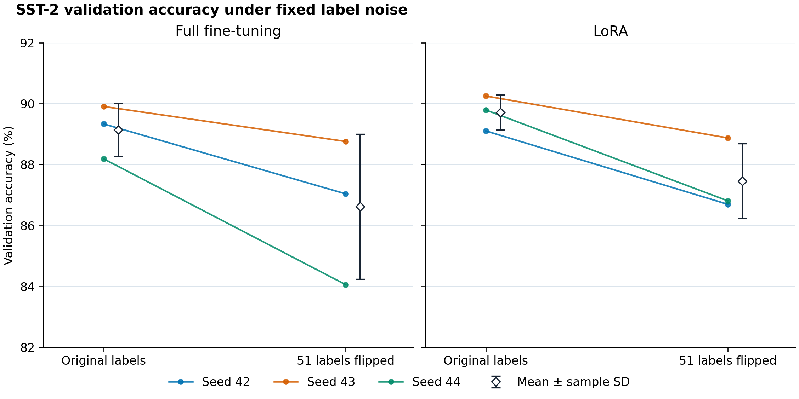
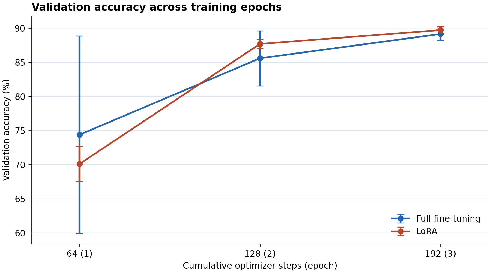

# 第四周实验验收与报告材料

2026 年 11 月 28 日核对。正式缩小规模实验在 11 月 22 日于单张 Tesla V100-SXM2-32GB 完成。本周从原始备份补齐种子 44 的配置、训练步次、参数检查、最佳预测和回读证据，并从仓库记录复算了 **12 次运行、36 份逐轮预测、31,392 条验证记录**。三个种子的样本顺序重新生成后与 12 次训练记录一致。留存的 12 份云端权重回读结果也与各次指标、选轮和权重摘要相符。

原始运行见 [种子 42](../../records/week03/seed42_20261122)、[种子 43](../../records/week03/seed43_20261122)、[种子 44](../../records/week03/seed44_20261122)。完整验收见 [逐轮复算与三种子汇总](../../records/week04/20261128/accepted_results.json)。本周的本机验证与 11 月 22 日的 V100 训练分别留有记录。

## 可用于英文报告的结果表

| 条件 | FT，准确率 % | LoRA，准确率 % | LoRA − FT，百分点 |
|---|---:|---:|---:|
| 原始训练标签 | 89.14 ± 0.88 | 89.72 ± 0.58 | +0.57 |
| 固定翻转 51 条训练标签 | 86.62 ± 2.38 | 87.46 ± 1.23 | +0.84 |

表中为种子 42、43、44 的均值 ± 样本标准差。所有运行采用同一套 512 条训练样本和完整的 872 条有标签验证样本，训练 3 轮、192 步，每轮评估，选择验证准确率最高的一轮。若同分，取最早轮次。12 次实跑的最佳轮次都是第 3 轮。

扩展固定翻转约 9.96% 的训练标签，两个方法和三个种子使用同一组翻转位置。逐种子比较原始条件与翻转条件，FT 下降 **2.52 ± 1.50** 个百分点，LoRA 下降 **2.26 ± 0.81** 个百分点。这个观察适用于这组固定翻转。同一条件下只有三个训练种子，扩展结论按这组噪声设置表述。



*图 1。每条线连接一个种子在两种条件下的结果，菱形和误差线表示均值与样本标准差。*

## 和论文 Table 2 对照

| 方法 | 论文 Table 2 的 SST-2 数字 | 本组原始标签验证准确率 % | 本组 − 论文，百分点 | 相对论文 |
|---|---:|---:|---:|---:|
| FT | 94.8% | 89.14 ± 0.88 | −5.66 | −5.97% |
| LoRA | 95.1 ± 0.2% | 89.72 ± 0.58 | −5.38 | −5.66% |

Table 2 的 FT 行标为既有工作结果。附录 D.1 说明 LoRA 取五个种子中位数、每次取最佳轮次。表中论文数值保留原文展示的统计口径。附录 Table 9 的 RoBERTa-base／SST-2 LoRA 配置为批次 16、60 轮、最大长度 512、r=8、alpha=8；本组明确采用小规模训练 512 条、批次 8、3 轮、长度 128，以及本组的验证和汇总协议。报告应把横向数值对照和本组内部可控比较分开解释。[LoRA 原论文，Table 2 与附录 D](https://arxiv.org/abs/2106.09685)

**可以检验的两项主张。** 参数量结果支持 LoRA 减少可训练参数的主张。FT 为 124,647,170，LoRA 含分类头为 887,042，减少 99.29%。其中 Q/V 的 LoRA 参数为 294,912，加上分类头 592,130。准确率结果对小规模场景提供部分支持，LoRA 均值比 FT 高 0.57 个百分点，种子 42 低 0.23 个百分点，种子 43 和 44 分别高 0.34 和 1.61 个百分点。报告结论可写为 **partially reproduced**，并明确适用范围。

**差异分析的实测证据。** 保持每次训练的样本、方法、种子和验证集不变，用同一训练过程中 64、128、192 步的预测核对预算内的学习进展。原始标签条件下，FT 三种子均值为 **74.39 → 85.59 → 89.14%**，LoRA 为 **70.11 → 87.69 → 89.72%**。从第 2 轮到第 3 轮仍分别增加 3.56 和 2.03 个百分点。这个对照支持训练进展在本协议内影响准确率。论文差距同时伴随训练规模、预算、长度和统计口径的变化，单个因素的贡献仍需要单独对照。



*图 2。原始标签条件下，同一训练轨迹的逐轮验证准确率。误差线为三个种子的样本标准差。*

## 验证与复现

训练代码固定在 [7fcffbb6，PR #6](https://github.com/sushi132412312/miae01-paper-replication/tree/7fcffbb6aa7170a93692abf8a40417ee56f56722)。本周回读入口在加载模型前核对原训练协议、验证样本清单和逐轮选优。26 项既有回归与 12 次合成回读通过。两个新增对照分别同步修改了保存的最佳轮次、修改了 LoRA alpha，回读均拒绝了不一致记录。参见 [回归记录](../../records/week04/20261128/regression_test_results.txt) 和 [回读验收](../../records/week04/20261128/replay_validation.json)。

在仓库根目录执行 `python tools/audit_v100_results.py --output local_runs/verified_v100.json` 可用 Python 标准库复算。带 `--verify-sample-order` 会另外用 CPU PyTorch 重建样本顺序。训练命令、V100 环境及源版本在 [项目 README](../../README.md)。需要重新制图时，在绘图环境安装 `matplotlib==3.10.8`，再执行：

```bash
python tools/plot_v100_results.py records/week04/20261128/accepted_results.json --output local_runs/figures
```

## 下周收尾分工

按 11 月 30 日到 12 月 6 日收尾。11 月 30 日至 12 月 2 日，各自交英文段落和引用；12 月 3 日至 5 日合稿、做展示和演练；最终检查完成后提交英文 PDF 并打 `v1.0` 标签。

| 成员 | 要交的报告内容 | 本人确认的证据 |
|---|---|---|
| 郑子俊 | Introduction、Claims、Setup，合稿和最终 README | 核对原论文与本组设置差异、种子 42 四次运行及复现命令 |
| 黄翊轩 | LoRA 实现、参数量、回读与硬件部分 | 核对 294,912／887,042 两个口径、种子 43 记录和回读修复 |
| 林树辉 | Results、Extension、Discrepancy analysis | 独立复算全组表格、两份图及种子 44 补齐记录 |

三人各自提交真实工作证据。最终报告按要求填写 contribution statement 和 AI usage statement。
